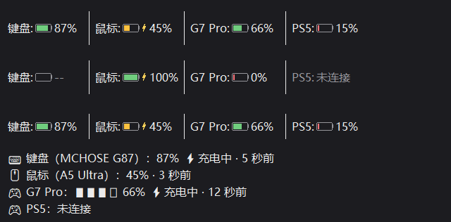
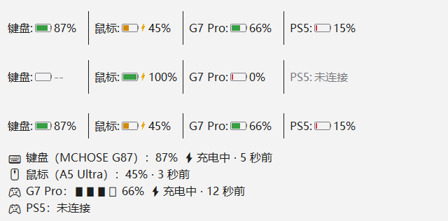
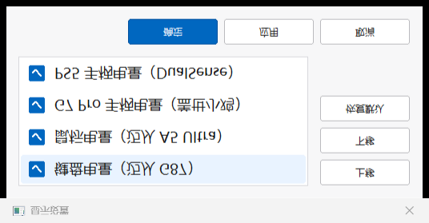

# PeripheralBattery

[TrafficMonitor](https://github.com/zhongyang219/TrafficMonitor) 外设电量显示插件 —— 在任务栏一眼看清键盘、鼠标、手柄的电量。


## 支持设备

| 设备 | 连接方式 |
| --- | --- |
| 迈从（MCHOSE）G87 2.4G 键盘 | USB 接收器 |
| 迈从（MCHOSE）A5 Ultra 2.4G 鼠标 | USB 接收器 |
| 盖世小鸡（GameSir）G7 Pro 2.4G 手柄 | USB 接收器 |
| PS5 DualSense 手柄 | 经 [DS5Dongle](https://github.com/awalol/DS5Dongle) 桥接为 USB |

## 显示效果

任务栏为每个设备绘制一段「名称: 电池图形 + 百分比」，设备间以细竖线分隔：

- **电量配色分级**：≥60% 绿色 / 20~59% 黄色 / <20% 红色，一眼识别电量状态
- **充电指示**：充电中电池旁显示金色闪电 ⚡
- **状态区分**：
  - 正常：电池按电量比例填充 + 百分比
  - 暂无读数（键盘/鼠标休眠唤醒中）：空电池 + `--`
  - 未连接（手柄关机/断开）：整段弱化灰，显示 `未连接`
- **自绘适配**：电池尺寸随任务栏字体缩放（DPI 自适应），文字绘制与 TrafficMonitor 自带条目同一基线，深浅色任务栏自动适配
- **悬停详情**：鼠标悬停查看每设备一行式详情（图标 + 电量、充电状态、更新时间），产品名与"X 分 X 秒前"式更新时间都在

各状态效果（上：常规；中：边界状态；下：任务栏实际高度）：





## 显示设置

插件自带 Win11 风格的选项对话框（插件管理 → 选项设置）：

- 勾选要在任务栏显示的设备
- 上移 / 下移调整显示顺序，恢复默认一键还原
- 「应用」按钮即时预览，「确定」持久化到 `PeripheralBattery.ini`



## 各设备读取方式

| 设备 | 通道 | 电量来源 |
| --- | --- | --- |
| G87 键盘 | HID（VID\_41E4），0x13 协议帧 | 查询响应 `[5]=电量`，`[6]&0x10=充电` |
| A5 Ultra 鼠标 | HID（VID\_3837 / PID\_100C，UsagePage 0xFF01） | `SetFeature(11 06)` 请求 → `GetFeature(0x11)` 读响应 `[11]=电量`，`[12]=充电` |
| G7 Pro 手柄 | `\\.\XboxGIP` 总线只读旁观 | 设备主动上报的 Status 消息，低 2 位为 0~3 档（0/33/66/100%），bit4 充电 |
| DualSense | USB HID（VID\_054C / PID\_0CE6） | Input Report 0x01 byte[53]：低 4 位档位 0~10（`min(档位×10+5,100)`），高 4 位充电状态 |

## 刷新策略

以"不吵醒设备"为第一原则，各设备策略不同：

- **键盘 / 鼠标**：无周期轮询。唤醒瞬间查一次；使用中（30 秒内有按键/移动）每 5 秒刷新；闲置即停，设备自然休眠；休眠时保持最后读数
- **G7 Pro**：纯被动监听总线消息，不发送任何请求；90 秒无消息视为断开显示 `未连接`
- **DualSense**：每 2 秒做一次本地 PnP 枚举检测在位（零 USB 请求）；在位时每 60 秒被动读一次，断开显示 `未连接`

查询时临时打开设备句柄、读完立即关闭（即查即关）：不影响设备休眠，不与官方驱动 / 网页驱动争用配置会话，无需关闭本插件即可正常使用官方软件。

## 安装

1. 从 [Release](../../releases) 下载 `PeripheralBattery.dll`
2. 复制到 TrafficMonitor 的 `plugins` 目录
3. 重启 TrafficMonitor，在 **选项设置 → 任务栏 → 显示设置** 中勾选「外设电量显示」

## 编译

需要 Visual Studio（"使用 C++ 的桌面开发"工作负载）和 Windows SDK，然后运行：

```
build.bat
```

输出 `out\PeripheralBattery.dll`。

## 目录结构

```
src/
  common/                公共头文件（PluginInterface.h / HidApi.h / BatteryCommon.h）
  keyboard/              G87 键盘协议层与后台线程
  mouse/                 A5 Ultra 协议层与后台线程
  dualsense/             DualSense 协议层与后台线程
  g7/                    G7 Pro GIP 监听与后台线程
  plugin/                插件主类、显示项与任务栏绘制
    BatteryDraw.h        任务栏电池图形绘制与布局（纯 GDI，独立无依赖）
    Plugin.*             插件主类（ITMPlugin）、选项对话框
    PeripheralItem.*     显示项（IPluginItem 自绘）
    dllmain.cpp          DLL 入口
docs/                    说明文档截图
build.bat                一键编译脚本
tools/                   开发用逆向/预览工具（不参与编译，gitignore）
```

架构说明：每个设备一对 `XxxDevice`（协议）+ `XxxReader`（后台线程），通过 mutex 保护的快照向 UI 供数；线程即查即关句柄、可被 Stop 打断；任务栏绘制集中在 `BatteryDraw.h`，与插件逻辑解耦。

## 已知限制

- G7 Pro 系统层只能读到 4 档电量（0/33/66/100%），精确百分比是 GameSir 私有协议（Nexus 专有），系统层不可获得
- DualSense 需经 DS5Dongle 桥接为 USB 形态；蓝牙直连读不到

## 更新记录

- **0.2.0** 任务栏自绘电池图形 UI（配色分级 / 充电闪电 / 未连接灰显）、Win11 风格选项对话框、悬停一行式详情提示；修复线程重启竞态、异步 IO 取消悬挂、HID 路径缓存失效等缺陷
- **0.1.x** 最初版本：四设备电量读取 + 文本显示

## License

MIT
